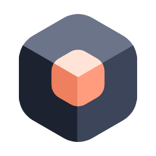

<p align="center">
  <picture>
    <source media="(prefers-color-scheme: dark)" srcset="frontend/public/logo-dark.svg">
    
  </picture>
</p>

<h1 align="center">Nestboard</h1>

<p align="center"><b>English</b> · <a href="README.zh-CN.md">简体中文</a></p>

<div align="justify">

> An open-source, self-hosted architecture diagram editor: boxes can go **inside** boxes.

Most drawing tools give you one flat canvas: one diagram per page. To describe a system at several levels of detail, you have to draw several diagrams side by side and link them to each other by hand.

**Nestboard** treats a diagram as a tree. Every box is also a canvas. Double-click a box to zoom into it and draw what's inside; double-click the background (or press `Esc`) to go back up a level.

It's a web app made of a frontend and a backend (FastAPI + PostgreSQL), deployed with Docker on your own machine or server. Diagrams are stored in the backend; team members sign in, draw together in the same project, and see each other's changes live. Around the diagrams there's permission management for organizations and projects, and architecture decision records (ADRs).

> ✅ **Status: v1.0 is complete.**

---

## 💡 Why

- 🪆 **Naturally nested.** Context → container → component → code is just one example of a hierarchy. Microservices, DDD bounded contexts, org charts and network topologies are all trees of "things inside things".
- 🧭 **Not tied to C4.** The tool gives you nesting to any depth; what each level is called is up to you.
- 🎨 **Visual first.** No DSL to learn: draw straight on the canvas.
- 🔓 **Open source, self-hosted.** Your data lives in a database you deploy, with no third-party service in between. Diagrams can also be exported as JSON files (see [JSON file format](./docs/file-format.md)) to keep in Git, or to import into another Nestboard.

Inspired by [IcePanel](https://icepanel.io)'s "zoom into a box" experience, but open source, and with double-click navigation.

## 🧩 Core idea

Think of it as a file system: every box is a folder, "zooming in" is `cd`, and the breadcrumb is your current path.

```
Root canvas
├── Box A
│   ├── Box A1
│   └── Box A2
│       └── Box A2a
└── Box B
```

Each node owns its children and the connections between them. A connection between two boxes is stored on the level of their lowest common ancestor. The format used when saving to a file is described in [JSON file format](./docs/file-format.md).

## ✨ Features

- 🔍 **Nesting to any depth:** double-click to enter a box, double-click the background or press `Esc` to go back; the breadcrumb shows where you are and jumps to any level
- 🔗 **Connections across levels:** on the levels above they're "lifted" to the boxes that contain their ends; inside a box, lines leaving the level end on external boxes
- 🏷️ **Box and connection types:** 39 box types (including vector database, LLM and AI agent), 10 connection types; technologies are picked from each type's list, over 400 of them with logos
- ✏️ **Editing:** multi-select, copy and paste (across levels and diagrams), alignment guides and equal spacing, undo/redo (of your own changes only)
- 👥 **Live collaboration:** changes save as you make them; people with the same diagram open see each other's changes, levels, selected boxes and pointers
- 🔐 **Organizations, projects and permissions:** invitation links, nested groups, Viewer / Editor / Owner roles, and single boxes can be handed to an owner
- 📝 **Architecture decision records (ADRs):** linked to boxes and connections, with a proposed → accepted / rejected → superseded flow and history, exportable as Markdown
- 📤 **Export:** PDF (like a report, one page per level) and JSON files
- ❓ **Help:** a shortcut list and getting-started guide inside the editor (File menu → Help, or press `?`)

> More in [Features](./docs/FEATURES.md), the [Roadmap](./docs/ROADMAP.md), the [box type spec](./docs/box-type-specs.md) and the [connection type spec](./docs/edge-type-specs.md).

## 🛠️ Running locally

The repository has two parts: `frontend/` (the editor and the other web pages) and `server/` (the backend, which stores diagrams and ADRs). Diagrams are stored in the backend, so start the backend first, then the frontend.

The backend is in `server/` and runs PostgreSQL in Docker; see the [backend notes](./server/README.md) (in Chinese):

```bash
docker compose up -d --wait   # database + backend; API docs at http://localhost:8000/api/v1/docs
```

The frontend needs Node.js 22 or later. The dev server forwards `/api` to the backend at `http://localhost:8000` (set the `NESTBOARD_API_URL` environment variable to use another address):

```bash
cd frontend
npm install
npm run dev        # start the dev server
npm test           # unit tests (Vitest)
npm run test:e2e   # end-to-end tests (Playwright, using this machine's Microsoft Edge by default)
npm run build      # production build
```

The first time you open the frontend (<http://localhost:5173>), follow the prompt to create the first account: it's this Nestboard's instance admin and can create organizations. Create a project in an organization and you can start drawing. Others join through the organization's invitation links.

The end-to-end tests start a backend of their own on port 8001, using the test database `nestboard_test`; before running them, only the database needs to be up (`docker compose up -d db`) and `server/.venv` set up as the backend notes describe. The tests run against a built frontend (a development-mode build in `frontend/dist-e2e`, on port 5179) rather than the dev server, which slows down badly when several browsers load pages at once. To run two sets of tests at the same time (for example two people or two AI sessions on the same code), give the second set its own ports and output folder, e.g. `E2E_PORT=5189 E2E_API_PORT=8011 npx playwright test --output=test-results-2`. Set `E2E_SERVER_LOGS=1` to see the test backend's request log. Before the tests start, they sign in to the test database as `e2e@example.com` (created on the first run) and prepare the organization `E2E` and the project `E2E project` (found by name); every test runs signed in, in that project. Tests that must not affect each other (such as ADR numbering) each create a project of their own. If `nestboard_test` holds other accounts, run the backend tests once first (they empty it when they finish).

`examples/box-types-gallery.json` and `examples/connection-types-gallery.json` contain every box type and every connection type; open them with "Import from file" in the File menu.

## 🚀 Production (to try locally)

`docker-compose.prod.yml` runs all three parts the way a real deployment would: the database, the backend, and the frontend served by [Caddy](https://caddyserver.com/). The browser talks only to Caddy: it serves the built pages (precompressed with Brotli and gzip; hashed files under `/assets` are cached for a long time, the page itself is checked for updates every time) and forwards `/api` to the backend, including the live connections of open diagrams (WebSocket, which Caddy forwards automatically; any other proxy put in front must allow WebSocket too). The database and the backend expose no ports: the three containers share an internal network Docker creates for the project and reach each other by service name (Caddy forwards to `api:8000`, the backend connects to `db:5432`); only Caddy's port 8080 is open on this machine.

```bash
cp .env.example .env    # then fill in a database password in .env
docker compose -f docker-compose.prod.yml up -d --build --wait   # open http://localhost:8080
docker compose -f docker-compose.prod.yml down                   # stop (data stays in nestboard-prod_pgdata)
```

Its project name is `nestboard-prod` (containers `nestboard-prod-db-1`, `nestboard-prod-api-1`, `nestboard-prod-web-1`) and its database has its own volume, so it can run next to the development `nestboard` without either affecting the other. The first time you open it, follow the prompt to create this environment's own admin account. `.env` holds a password: don't share or commit it.

To serve it on a real domain: change `:80` in `frontend/Caddyfile` to the domain, open ports 80 and 443, and set `NESTBOARD_SITE` (the https address) and `NESTBOARD_COOKIE_SECURE=true` in `.env`; Caddy gets the HTTPS certificate automatically.

### 🤔 Which environment when

| | 🧪 Development (`nestboard`) | 🏭 Production (`nestboard-prod`) |
|---|---|---|
| Purpose | Everyday coding: frontend with `npm run dev` (<http://localhost:5173>, reloads on save), backend in Docker or on this machine | Seeing what users actually get: production build, on-demand loading, compression, caching, Caddy's forwarding |
| When | Every day, while changing code and running tests | Final check before a feature is done, measuring performance (development builds are several times slower, so their numbers are off), showing the app to others, keeping data you want to keep |
| Data | Test data you can lose any time; some database migrations empty it | Data to keep; back it up before updating |

The two environments are fully separate: they share no database and no accounts. Note that the development backend container is also built from the code as it was when it started: after changing backend code, rebuild it with `docker compose up -d --build` (or run the backend on this machine as the backend notes describe, where code changes reload automatically).

### 📦 Bringing changes to production

Production never updates by itself: each build uses the code in the folder at that moment. So:

1. Finish a set of changes in development, with the unit and end-to-end tests passing and `npm run build` (the production build) in `frontend` succeeding: the end-to-end tests use a development-mode build, which splits the code differently from the production build, and some problems only show up in the production build. Don't update production halfway through a change, or it gets the half-finished version.

   ```bash
   docker compose up -d --build --wait
   ```

2. If production holds data you want to keep, back it up first (the backend runs database migrations when it starts, and some migrations empty the data). The backup is made inside the database container and then copied out, which also works in PowerShell (writing the output to a file with `>` makes PowerShell change the file's encoding, which breaks the backup):

   ```bash
   docker compose -f docker-compose.prod.yml exec db pg_dump -U nestboard -Fc -f /tmp/nestboard.dump nestboard
   docker compose -f docker-compose.prod.yml cp db:/tmp/nestboard.dump ./nestboard.dump
   ```

   The backup holds everyone's data (including password hashes): like `.env`, don't share or commit it.

3. Rebuild and start (the data stays):

   ```bash
   docker compose -f docker-compose.prod.yml up -d --build --wait
   ```

4. Open <http://localhost:8080> and click through what changed.

To restore from a backup (this replaces the data currently in the database):

```bash
docker compose -f docker-compose.prod.yml cp ./nestboard.dump db:/tmp/nestboard.dump
docker compose -f docker-compose.prod.yml exec db pg_restore -U nestboard -d nestboard --clean --if-exists /tmp/nestboard.dump
```

## 🧰 Tech stack

- [React](https://react.dev/) + [TypeScript](https://www.typescriptlang.org/)
- [Vite](https://vitejs.dev/)
- [@xyflow/react](https://reactflow.dev/) for the canvas and diagram interaction
- [Zustand](https://zustand.docs.pmnd.rs/) + [zundo](https://github.com/charkour/zundo) for state and undo/redo
- [Tailwind CSS](https://tailwindcss.com/) + [Radix UI](https://www.radix-ui.com/) for the interface (in English, dark theme only)
- [cmdk](https://cmdk.paco.me/) for the searchable type pickers
- [Lucide](https://lucide.dev/) for interface and type icons
- [Simple Icons](https://simpleicons.org/) (CC0) and [SVG Logos](https://github.com/gilbarbara/logos) (CC0) for technology logos; each brand's logo belongs to its owner
- [Vitest](https://vitest.dev/) for unit tests, [Playwright](https://playwright.dev/) for end-to-end tests
- Backend: Python 3.12, [FastAPI](https://fastapi.tiangolo.com/), [SQLAlchemy](https://www.sqlalchemy.org/) + [Alembic](https://alembic.sqlalchemy.org/), [PostgreSQL](https://www.postgresql.org/) (Docker), tested with [pytest](https://pytest.org/)

## 📄 License

[MIT](LICENSE)

</div>
