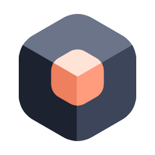

<p align="center">
  <picture>
    <source media="(prefers-color-scheme: dark)" srcset="frontend/public/logo-dark.svg">
    
  </picture>
</p>

<h1 align="center">Nestboard</h1>

<p align="center"><a href="README.md">English</a> · <b>简体中文</b></p>

<div align="justify">

> 一个开源、自己部署的架构图编辑器:框,可以放在框**里面**。

大多数绘图工具只给你一张平铺的画布:一页一张图。想在多个细节层次上描述一个系统,你只能把多张图并排画出来,再手动互相链接。

**Nestboard** 把图表看作一棵树。每个框同时也是一块画布。双击一个框,放大进入它,画出它的内部;双击背景(或按 `Esc`),再退回上一层。

它是一个网页应用,由前端和后端(FastAPI + PostgreSQL)组成,用 Docker 部署在你自己的机器或服务器上。图表保存在后端,团队成员登录后在同一个项目里一起画、实时看到彼此的改动;围绕图表,还有组织与项目的权限管理和架构决策记录(ADR)。

> ✅ **状态: v1.1 已完成。**

---

## 💡 为什么做它

- 🪆 **天然嵌套。** 上下文 → 容器 → 组件 → 代码只是层级结构的一个例子。微服务、DDD 限界上下文、组织架构、网络拓扑,本质上都是"事物之中还有事物"的树。
- 🧭 **不绑定 C4。** 工具只提供任意深度的嵌套,每一层叫什么由你决定。
- 🎨 **可视化优先。** 不需要学习任何 DSL,直接在画布上画。
- 🔓 **开源,自己部署。** 数据在你自己部署的数据库里,不经过第三方服务。图表也可以导出为 JSON 文件(格式见[JSON 文件格式](./docs/file-format.zh-CN.md)),放进 Git 做版本管理,或导入到另一个 Nestboard。

灵感来自 [IcePanel](https://icepanel.io) 的"放大进入一个框"的体验,但本项目开源,并且支持双击导航。

## 🧩 核心概念

把它想成文件系统:每个框是一个文件夹,"放大进入"就是 `cd`,面包屑就是你当前所在的路径。

```
根画布
├── 框 A
│   ├── 框 A1
│   └── 框 A2
│       └── 框 A2a
└── 框 B
```

每个节点拥有自己的子节点,以及子节点之间的连线。两个框之间的连线,存放在它们最近公共祖先所在的那一层。保存到文件时的格式见[JSON 文件格式](./docs/file-format.zh-CN.md)。

## ✨ 功能

- 🔍 **任意深度的嵌套:** 双击进入框、双击背景或按 `Esc` 返回,面包屑显示并跳转到任意层级
- 🔗 **跨层级的连线:** 在上层"提升"显示在包含两端的框之间;进入框后,离开这一层的连线画到外部框上
- 🏷️ **框和连线的类型:** 39 种框类型(含向量数据库、大模型、AI 智能体等)、10 种连线类型;技术从各类型的清单中选择,四百多种技术带标志
- ✏️ **编辑:** 多选、复制粘贴(可跨层级、跨图表)、对齐辅助线与等距分布、撤销/重做(只撤销自己的改动)
- 👥 **多人实时协作:** 改动边做边保存;同时打开的人互相看到改动、所在层级、选中的框和指针
- 🔐 **组织、项目与权限:** 邀请链接、可嵌套的组、Viewer / Editor / Owner 三种角色,可以把单个框交给负责人
- 📝 **架构决策记录(ADR):** 关联到框和连线,有提议 → 接受 / 否决 → 取代的流转和历史,可导出为 Markdown
- 📤 **导出:** PDF(像报告一样,每层一页)和 JSON 文件
- ❓ **帮助:** 编辑器内的快捷键列表和入门介绍(文件菜单 → Help,或按 `?`)

> 详见[功能](./docs/FEATURES.zh-CN.md)、[路线图](./docs/ROADMAP.zh-CN.md)、[框类型设计规格](./docs/box-type-specs.zh-CN.md)和[连线类型设计规格](./docs/edge-type-specs.zh-CN.md)。

## 🛠️ 本地运行

仓库分为两部分:`frontend/`(编辑器等网页界面)和 `server/`(后端,保存图表和 ADR)。图表保存在后端,所以先启动后端,再启动前端。

后端在 `server/` 目录,用 Docker 运行 PostgreSQL,详见[后端说明](./server/README.md):

```bash
docker compose up -d --wait   # 数据库 + 后端,接口文档在 http://localhost:8000/api/v1/docs
```

前端需要 Node.js 22 或更高版本。开发服务器会把 `/api` 转发到 `http://localhost:8000` 的后端(可用环境变量 `NESTBOARD_API_URL` 改为其他地址):

```bash
cd frontend
npm install
npm run dev        # 启动开发服务器
npm test           # 单元测试(Vitest)
npm run test:e2e   # 端到端测试(Playwright,默认使用本机的 Microsoft Edge)
npm run build      # 生产构建
```

第一次打开前端(<http://localhost:5173>)时,按提示创建第一个账号:它是这个 Nestboard 的实例管理员,可以新建组织;在组织里新建项目后,就能开始画图。其他人通过组织的邀请链接加入。

端到端测试会自动在 8001 端口另起一个后端,使用测试数据库 `nestboard_test`;运行前只需数据库在运行(`docker compose up -d db`),并按后端说明建好 `server/.venv`。测试针对构建好的前端运行(开发模式构建,输出到 `frontend/dist-e2e`,端口 5179),而不是开发服务器:开发服务器在多个浏览器同时加载页面时会严重变慢。两组测试同时运行时(例如两个人或两个 AI 会话在同一份代码上),第二组请用不同的端口和输出目录,例如 `E2E_PORT=5189 E2E_API_PORT=8011 npx playwright test --output=test-results-2`。需要查看测试后端的请求日志时,设置 `E2E_SERVER_LOGS=1`。测试开始前会在测试数据库里登录账号 `e2e@example.com`(第一次运行时创建它),并准备好组织 `E2E` 和项目 `E2E project`(按名称查找),所有测试都在这个项目里、以已登录的状态运行;需要互不影响的测试(如 ADR 编号)各自新建一个项目;如果 `nestboard_test` 里有其他账号,先运行一次后端测试(结束时会清空它)。

`examples/box-types-gallery.json` 和 `examples/connection-types-gallery.json` 分别包含所有框类型和所有连线类型,可用文件菜单中的"从文件导入"打开查看。

## 🚀 生产环境(本地试用)

`docker-compose.prod.yml` 像正式部署一样运行全部三部分:数据库、后端,以及用 [Caddy](https://caddyserver.com/) 提供网页的前端。浏览器只连接 Caddy:它提供构建好的网页(预先压缩为 Brotli 和 gzip;`/assets` 下带哈希的文件长期缓存,页面本身每次检查更新),并把 `/api` 转给后端,包括打开的图表的实时连接(WebSocket,Caddy 会自动转发;如果前面再加别的代理,它也必须允许 WebSocket)。数据库和后端不对外开放端口:三个容器在 Docker 为这个项目建立的内部网络里,用服务名互相访问(Caddy 转发到 `api:8000`,后端连接 `db:5432`),只有 Caddy 的 8080 端口开放到本机。

```bash
cp .env.example .env    # 然后在 .env 里填一个数据库密码
docker compose -f docker-compose.prod.yml up -d --build --wait   # 打开 http://localhost:8080
docker compose -f docker-compose.prod.yml down                   # 停止(数据保留在 nestboard-prod_pgdata)
```

它的项目名是 `nestboard-prod`(容器为 `nestboard-prod-db-1`、`nestboard-prod-api-1`、`nestboard-prod-web-1`),数据库用自己的数据卷,所以可以和开发用的 `nestboard` 同时运行,互不影响。第一次打开时,按提示创建这个环境自己的管理员账号。`.env` 里有密码,不要分享或提交它。

换成正式域名时:把 `frontend/Caddyfile` 里的 `:80` 改成域名,开放 80 和 443 端口,并在 `.env` 里设置 `NESTBOARD_SITE`(https 地址)和 `NESTBOARD_COOKIE_SECURE=true`;Caddy 会自动申请 HTTPS 证书。

### 🤔 什么时候用哪个环境

| | 🧪 开发环境(`nestboard`) | 🏭 生产环境(`nestboard-prod`) |
|---|---|---|
| 用途 | 日常写代码:前端 `npm run dev`(<http://localhost:5173>,保存即刷新),后端在 Docker 或本机运行 | 看用户实际拿到的样子:正式构建、按需加载、压缩、缓存、Caddy 的转发 |
| 什么时候用 | 每天,改代码和跑测试的时候 | 一个功能完成前做最后检查、测量性能(开发构建慢好几倍,数字不准)、给别人演示、存放要保留的数据 |
| 数据 | 随时可丢的测试数据;有些数据库迁移会清空它 | 要保留的数据,更新前先备份 |

两个环境完全独立:数据库、账号都不共享。注意开发环境的后端容器也是按启动时的代码构建的,改了后端代码要用 `docker compose up -d --build` 重新构建(或者按后端说明在本机运行,代码改动自动重载)。

### 📦 把改动带到生产环境

生产环境不会自动更新:每次构建时,它用的是文件夹里当时的代码。所以:

1. 在开发环境里完成一组改动,单元测试和端到端测试都通过,并且 `frontend` 里的 `npm run build`(正式构建)也成功:端到端测试用的是开发模式构建,代码的拆分方式和正式构建不同,有些问题只在正式构建里出现。不要在改到一半时更新生产环境,否则它会拿到半成品。

  ```bash
  docker compose up -d --build --wait
  ```

2. 如果生产环境里有要保留的数据,先备份(后端启动时会自动执行数据库迁移,而有些迁移会清空数据)。备份在数据库容器里生成,再复制出来,这样在 PowerShell 里也能用(用 `>` 把输出写进文件时,PowerShell 会改变文件的编码,备份就坏了):

   ```bash
   docker compose -f docker-compose.prod.yml exec db pg_dump -U nestboard -Fc -f /tmp/nestboard.dump nestboard
   docker compose -f docker-compose.prod.yml cp db:/tmp/nestboard.dump ./nestboard.dump
   ```

   备份里有所有人的数据(包括密码的哈希),和 `.env` 一样不要分享或提交。

3. 重新构建并启动(数据保留):

   ```bash
   docker compose -f docker-compose.prod.yml up -d --build --wait
   ```

4. 打开 <http://localhost:8080>,把改动的地方点一遍。

需要从备份恢复时(会替换数据库里现有的数据):

```bash
docker compose -f docker-compose.prod.yml cp ./nestboard.dump db:/tmp/nestboard.dump
docker compose -f docker-compose.prod.yml exec db pg_restore -U nestboard -d nestboard --clean --if-exists /tmp/nestboard.dump
```

## 🧰 技术栈

- [React](https://react.dev/) + [TypeScript](https://www.typescriptlang.org/)
- [Vite](https://vitejs.dev/)
- [@xyflow/react](https://reactflow.dev/),用于画布和图交互
- [Zustand](https://zustand.docs.pmnd.rs/) + [zundo](https://github.com/charkour/zundo),用于状态管理和撤销/重做
- [Tailwind CSS](https://tailwindcss.com/) + [Radix UI](https://www.radix-ui.com/),用于界面(界面语言:英文,仅暗色主题)
- [cmdk](https://cmdk.paco.me/),用于可搜索的类型选择器
- [Lucide](https://lucide.dev/),用于界面和类型图标
- [Simple Icons](https://simpleicons.org/)(CC0)和 [SVG Logos](https://github.com/gilbarbara/logos)(CC0),用于技术标志;各品牌标志归其所有者
- [Vitest](https://vitest.dev/) 用于单元测试,[Playwright](https://playwright.dev/) 用于端到端测试
- 后端:Python 3.12、[FastAPI](https://fastapi.tiangolo.com/)、[SQLAlchemy](https://www.sqlalchemy.org/) + [Alembic](https://alembic.sqlalchemy.org/)、[PostgreSQL](https://www.postgresql.org/)(Docker),测试用 [pytest](https://pytest.org/)

## 📄 许可证

[MIT](LICENSE)

</div>
